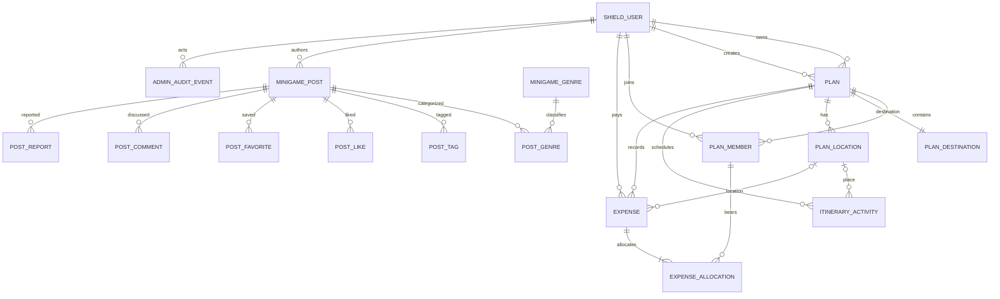

# Conditional Data Model and ERD Review

**Status**: Conditional conceptual model alongside the staged physical schema;
not a replacement for the supplied ERD. Approved non-audit business tables
have been created by CodeIgniter migrations; the original ERD remains unchanged.

**Evidence read**: [Current ERD image](../../../docs/database/ERD.png) and
[database note](../../../docs/database/database-note.md). Findings and UI
evidence limitations are also summarized in
[design-review.md](./design-review.md).

## Design principles

1. Implement only entities needed for confirmed FRs; do not infer subscriptions,
   booking, public Plan sharing, Plan likes/comments or location reviews.
2. Keep Shield as account/credential authority. Reference `users.id`; do not
   recreate password, email-authentication or role tables in the product schema.
3. Store expenses as individual source records, then store one or more member
   allocations per expense. Never use a member × location matrix as source data.
4. Compute totals from source expenses/allocations. Do not persist mutable
   `actual_total_cost`, member totals or location totals as authoritative facts.
5. Normalize genre/category definitions and post interactions. Enforce
   uniqueness and referential integrity; validate aggregate rules transactionally.
6. Preserve unresolved alternatives. A conceptual option is not a schema
   decision until the product owner approves its gate.

## Initial staged schema and approval record

The Product Owner approved proceeding with the staged schema without claiming
that the rest of the team has approved the conceptual ERD. Team review remains
pending. The existing ERD is preserved as-is and is not represented as the
physical database design.

The local physical schema now contains Shield authentication and all
business-table structures whose rules are resolved, including the Admin audit
table. Q-023 is resolved: audit events are stored in MySQL without a retention
deadline and may be read by Admins and system operators, with operator access
restricted outside the business-role model. The following tables were applied
through the Shield and application migrations:

| Table | Implemented responsibility | Key integrity rules |
|---|---|---|
| `plans`, `plan_members`, `plan_locations` | Plan ownership, direct membership and Plan locations. | Shield user FKs; unique membership; owner membership; Plan-scoped location; owner membership creation is transactional. |
| `itinerary_activities` | Day-grouped Plan itinerary and chronological/manual ordering. | Plan FK; optional start/end times; when both exist, end must be later; date and ordering constraints are validated by the application. |
| `expenses`, `expense_allocations` | Individual Plan costs and member-level allocation rows. | Required Plan/date/payer; payer and allocations reference members of the same Plan; optional location; positive integer VND; split method constrained; allocation total equality is enforced transactionally by the future service. |
| `minigame_genres`, `minigame_posts`, `minigame_post_genres`, `minigame_post_tags` | Normalized genre catalog, authored posts, genre associations and free-text tags. | Title/rules required; optional integer player bounds and duration; new posts are pending; genre/tag associations are separate rows; seed values are not included. |
| `minigame_post_likes`, `minigame_post_favorites`, `minigame_post_comments` | User interactions and comments. | Unique User/post like and favorite; comment author owns edit/delete actions. |
| `minigame_post_reports` | One report per User/post and Admin resolution state. | Required reason; unique reporter/post; keep/hide/soft-delete outcomes; post soft deletion retains report references. |
| `admin_audit_events` | Permanent record of Admin Plan/expense create, update and delete actions. | Stores actor, action, target type/ID, event time and optional minimal safe JSON metadata; actor FK restricts account deletion; target is intentionally polymorphic so history survives target deletion. |

`plans.owner_user_id`, `plan_members.user_id`, and
`plan_members.added_by_user_id` reference Shield's unsigned integer
`users.id`. User deletion is restricted while business records reference that
user; the project has no approved account-deletion workflow. The application
must create the Plan and its owner membership in one transaction. Other member
rows are added by the owner. Plan-member insertion order is retained with
`joined_at`, with `id` as a stable tie-breaker for the confirmed split-remainder
rule.

Destination source fields are vendor-neutral (`destination_source_key` and
`destination_source_reference`); no provider or provider-specific schema has
been selected. Itinerary date/time and expense field optionality are confirmed.
Minigame post filter fields, edit moderation, comment ownership and report
lifecycle are confirmed. Provider selection (Q-021), genre seed values
(Q-022), recommendation ranking (Q-020), and audit storage/retention/readers
(Q-020), provider selection (Q-021), and genre seed values (Q-022) remain open
but do not block these table structures. No subscription, payment, public
sharing, invite-code, or Plan-social tables are created.

The physical schema was created under explicit Product Owner authorization;
T004's team review remains outstanding. This does not approve or replace the
supplied ERD. Q-020 ranking/empty-state, Q-021 provider selection, and Q-022
genre seed values remain nonblocking to the tables already created.

The Shield migration and application migrations were applied to the local
Docker development database `travel_planner_db` on 2026-11-02. Follow-up
migrations make all business foreign keys to Shield users restrict account
deletion and add the permanent Admin audit table. No account-deletion workflow
is approved. Migration status and representative table metadata were verified
after application. All new business tables are empty; the pre-existing
`test_connection` table retains its one row. No production database, ERD, or
`database/init.sql` was changed.

## Shield-owned authentication and authorization data

The locked dependency is Shield v1.4.1. Its configured table names and migration
show that Shield owns:

| Table | Responsibility | Business-schema rule |
|---|---|---|
| `users` | Canonical account principal; primary key is unsigned integer `id`. | Every business actor/owner/member reference targets this principal key. |
| `auth_identities` | Credentials and authentication identities, including password/token identity material; FK to `users`. | Never point a Plan, expense or post at an identity row. Never copy `secret`, `secret2` or token values. |
| `auth_logins`, `auth_token_logins` | Login and token-login attempt records. | Do not use as application audit events or business activity. |
| `auth_remember_tokens` | Remember-me records; FK to `users`. | Not a business session or resource ownership record. |
| `auth_groups_users` | User/group assignments; FK to `users`. | Use Shield authorization APIs/configuration for role checks; do not create a duplicate role table. |
| `auth_permissions_users` | User-specific permission assignments; FK to `users`. | Use only for approved authorization capabilities; do not duplicate permission assignments in business tables. |

Shield's configured group names, permission catalog and group matrix are
configuration, not separate group/permission master tables in the inspected
Shield migration. The existing project config defines `user` and `admin`;
`user` is the default, `user` has no explicit permissions, and `admin` currently
has wildcard `*`. Guest is an anonymous actor, not a row/group. Treat these as
repository facts, not an approved final authorization policy.

The Shield migration cascades its identity, remember-token and group/permission
assignment records on user deletion, but preserves login-attempt history.
Business FK delete behavior is not implied by those Shield rules and must be
reviewed separately. No account-deletion workflow is established in the Spec.

## Shield User versus business profile

The ERD's `USER` has a string ID and combines account name/email/password hash,
avatar and premium/subscription attributes. This conflicts with Shield as the
selected account authority and with the confirmed MVP scope. The proposed ERD
should replace that conceptual account entity with Shield's `users` principal
and align every business FK to its unsigned integer `id`.

The Shield user table has a nullable username and account status/activity
fields; email and password identity data are held through `auth_identities`.
The Spec does not confirm whether the product needs a distinct display name,
avatar or editable profile. Do not invent a profile table. If those fields are
later approved and do not belong in Shield's account model, a candidate
`user_profiles` extension can use `user_id` as both its PK and FK to
`users.id` (one-to-one). Premium/subscription fields remain out of the
confirmed scope. This profile extension is a proposal only.

All business actor references below are conceptual direct FKs to the same
Shield `users.id` principal; names may change during physical schema design:

| Business relationship | User reference |
|---|---|
| Plan ownership and creation | `plans.owner_user_id`; the creating User/Admin is the owner under the confirmed flow. Do not duplicate the same principal in `created_by_user_id`; Admin CRUD audit records its actor separately. |
| Plan membership | `plan_members.user_id`, `plan_members.added_by_user_id`. |
| Expense | `expenses.payer_user_id`; in a group Plan the payer must be a current Plan member. |
| Minigame community | Post author, like/favorite user, comment author, report submitter/reviewer. |
| Admin audit | Acting Admin User ID; do not infer owner from actor. |
| Optional profile | `user_profiles.user_id`, only if profile fields are approved. |

Do not add business FKs to Shield `auth_identities`, token rows, group
assignments or permission assignments. Do not introduce user deletion cascades
for business records merely because Shield cascades its own auth-owned rows;
business deletion/retention behavior needs its own approved design.

## Conditional conceptual entities

| Entity | Conceptual fields (proposed; not final physical schema) | Relationships and rules |
|---|---|---|
| Shield User | Shield `users.id` (unsigned integer); account status/activity fields managed by Shield. | Canonical principal. One User may own Plans, join Plans, author expenses/posts/comments/reports and perform Admin actions. Business FKs reference `users.id`; email/password/token identity data remain in Shield tables. |
| Optional User Profile | Candidate `user_id` PK/FK, display name and/or avatar only if explicitly required. | Zero-or-one profile extension per Shield user; not part of MVP design until fields and editing behavior are approved. Do not duplicate email or credentials. |
| Plan | `id`, `owner_user_id`, title, description, start/end dates, one destination snapshot, itinerary sort mode, timestamps. | One owner; many member rows, itinerary activities, Plan locations and expenses. A User-created Plan is owned by that User; an Admin-created Plan is owned by that Admin. Do not add a separate `created_by_user_id` that duplicates the owner. Admin CRUD audit events record the actor separately. |
| Plan Member | `plan_id`, `user_id`, `added_by_user_id`, joined/added timestamp. | Unique `(plan_id,user_id)`. Owner/member visibility follows FR-007. Owner representation and any role field require one consistent invariant; do not duplicate `role=owner` and `owner_user_id` without a constraint. Removal is blocked while expense allocations refer to the member. |
| Plan Destination | One destination value per Plan: source kind (provider/manual), provider key and place ID only when provider-selected, display name, optional address and coordinates. | Exactly one per Plan. Manual fallback has no provider ID. Store a Plan snapshot so later provider changes do not silently rewrite trip records. The provider remains unselected (Q-021). |
| Plan Location | `id`, `plan_id`, display name, optional provider/place metadata and address/coordinates where applicable. | One Plan has zero or more places used by itinerary/expense summaries. The precise distinction between Plan's one trip destination and its many itinerary/expense locations is a design concern; do not force them to be the same record without review. |
| Itinerary Activity | `id`, `plan_id`, activity date, name, nullable start/end time, optional Plan Location reference, instructions, notes, manual order index. | Belongs to one Plan and one valid day in its inclusive date range. A Plan may start and end on the same day. Start/end times may be null independently; if both exist, end must be later than start. Timed activities default to start-time order; equal times retain insertion order. User may switch to and retain manual ordering. |
| Expense | `id`, required Plan reference, one current-member payer, optional Plan Location, positive whole-VND amount, required expense date, optional note, optional free-text category, split method, timestamps. | Every expense belongs to a Plan. A personal expense belongs to a private Plan that may contain only its owner; no standalone expense scope. One expense has exactly one payer. In a group Plan the payer must be a current member. One Plan/location may have many expenses. No payment transaction/refund/settlement state. |
| Expense Allocation | `expense_id`, `plan_member_id`, positive integer-VND amount. | Unique `(expense_id,member)`. Group Plan expenses allocate to one or more current Plan members; a personal Plan expense allocates to its owner. Sum of allocation amounts must equal expense amount. Split remainder follows Plan member order. Enforce cross-row sum in the service/database transaction; a simple row CHECK cannot validate a sum across rows. |
| Minigame Post | `id`, author User, required title and rules, optional description, optional integer minimum/maximum player counts, optional integer duration in minutes, equipment, cover asset reference, genre relation, timestamps, status. | One User authors many posts. A new post starts pending Admin approval and is not public until approved. Edits by the author to an approved post become public immediately without re-approval (Q-018c). Approved posts may be hidden/deleted by Admin under the confirmed moderation flow. Online gameplay/session entities are out of scope. |
| Minigame Genre | `id`, canonical name, active/seed metadata if needed. | Controlled normalized catalog used for genre filter. Seed values remain to be selected after competitor research (Q-022). |
| Post Genre | `post_id`, `genre_id`. | Unique pair; supports one or more catalog genres if confirmed. |
| Post Tag | `id`, `post_id`, normalized/free-text tag value. | Optional user-entered keywords are distinct from the controlled genre catalog. Avoid storing a delimited tag list in the post row; enforce normalized uniqueness per post. |
| Post Like | `post_id`, `user_id`, created timestamp. | Unique `(post_id,user_id)`; authenticated User only. |
| Post Favorite | `post_id`, `user_id`, created timestamp. | Unique `(post_id,user_id)`; private to its User. |
| Post Comment | `id`, `post_id`, `author_user_id`, content, created/updated timestamps. | A post has many comments. Authors may edit/delete their own comments. No reply/thread feature is specified. |
| Post Report | `id`, `post_id`, `reporter_user_id`, required reason text, status, resolution, `reviewed_by_user_id`, `reviewed_at`, timestamps. | Unique `(post_id, reporter_user_id)`. Status is pending/resolved; Admin resolution is keep/hide/soft-delete post. Soft-deleting a post retains reports and their FK relationships. |
| Admin Audit Event | `admin_audit_events`: actor, action (`create`/`update`/`delete`), target type (`plan`/`expense`), target ID, event timestamp, optional minimal safe JSON metadata. | Permanently stored in MySQL; Admins and system operators may read, with operator access restricted outside the business-role model. Audit Plan/expense writes, never read-only views. Do not store credentials, tokens or unnecessary content snapshots. |

### Resolved expense scope and Plan ownership

- Every expense has a required Plan reference. Personal expenses belong to a
  private Plan that may contain only its owner; there is no standalone expense.
- A group Plan expense's payer must be a current Plan member.
- The User or Admin creating a Plan is its owner. Therefore `owner_user_id`
  references that actor; do not add a duplicate `created_by_user_id`. Admin
  create/update/delete actions are attributed in the separate audit-event
  entity.

## Proposed conceptual relationships

This diagram is deliberately conceptual. Optionality and unresolved branches
are described above and do not yet define DDL/cardinality constraints.

The diagram reflects the confirmed expense scope, payer membership rule, and
Plan ownership rule. It remains conceptual, includes the deferred audit
concept, and is not a replacement of the supplied ERD or a complete depiction
of the physical schema.

## Review of the current ERD

| Current ERD concept | Finding | Proposed disposition |
|---|---|---|
| `USER` includes string `id`, `password_hash`, email, name/avatar and premium flags | Shield v1.4.1 owns the account principal (`users.id`, unsigned integer), while password/email identity data live in `auth_identities`. The Spec does not define business profile fields. Premium/subscription sales are not approved. | **Necessary**: replace the ERD's duplicate auth entity with Shield `users`; align all business User FKs to `users.id`; do not duplicate email/password/token secrets. **Conditional**: add a one-to-one profile extension only if display-name/avatar fields are approved. **Out of scope**: premium/subscription unless separately approved. |
| `PLAN` has `visibility=private|public`, `invite_code`, public costs | Public Plan sharing is explicitly not approved; only owner and directly-added members can read. No invitation-code join flow was approved. | **Necessary**: private owner/member authorization. Exclude public visibility and public invite codes from MVP. |
| `PLAN` stores estimated and actual total cost | Actual totals are aggregates of expense records; storing them independently risks update drift. Estimated total is not established as a requirement. | **Necessary**: calculate actual totals from source expenses. **Conditional**: retain estimated total only if owner approves it as product input. |
| `PLAN_MEMBER` has role/status but no visible uniqueness rule | Duplicate member rows can distort visibility and remainder ordering; role duplicates ownership if owner also appears in membership. Pending/inactive join states imply unapproved request/leave workflows. | **Necessary**: unique `(plan_id,user_id)` and define one owner/member invariant. Add statuses only for approved lifecycle. |
| `EXPENSE_SHARE` points to `LOCATION_ITEM` and `PLAN_MEMBER`, with amount owed/paid and paid state | There is no separate expense record/payer; one location item appears to stand in for expense history. `amount_paid`, `is_paid`, `paid_at` imply settlement, contrary to no repayment/payment feature. It cannot safely model multiple separate costs at one place. | **Necessary**: introduce Expense and per-expense allocations; record one payer; keep payment/settlement transactions out of scope. |
| `LOCATION_ITEM` has actual cost and estimated cost per head | Actual cost overlaps the proposed per-expense model and its relation to payer/allocation is unclear. | **Necessary**: actual cost must derive from expense records. Estimated cost can remain only if the team approves an itinerary estimate requirement. |
| `ROUTE` groups `LOCATION_ITEM` but has no explicit itinerary day/date | Confirmed workflow is activities grouped by Plan day, with start/end time and manual-order option. Route distance/duration/navigation are not confirmed. | **Necessary**: represent each itinerary activity with Plan and activity date, approved fields and order. **Out of scope**: route optimization/distance unless approved. |
| Plan destination is a free string; `LOCATION` is provider cache | Does not capture selected provider ID/name/address/coordinates as required. Provider cache data and terms are unspecified; an external provider is not selected. | **Necessary**: preserve selected destination ID/name and optional returned address/coordinates, with manual-entry origin. Provider-specific caching/retention is conditional on provider choice. |
| `MINI_GAME` lacks author, publish/moderation state, created time and genre relation | User posts and Admin moderation are confirmed. Current entity does not identify authorship or publication lifecycle; tags are only equipment/setting and not the confirmed genre catalog. | **Necessary**: add post author/timestamps, a pending-approval/publication state and genre relation; title and rules are required, other specified post fields are optional. Edits to approved posts publish immediately (Q-018c). |
| No minigame Like, Favorite, Comment or Report entities | Those interactions and reporting are confirmed for minigame posts; current `PLAN_*` interactions relate to Plans instead. | **Necessary**: model interactions against minigame posts with per-user uniqueness; comment ownership and report resolution are now confirmed and must be represented in the corresponding tables. |
| `PLAN_LIKE`, `PLAN_SAVE`, `PLAN_COMMENT`, `PLAN_SHARE`, `LOCATION_REVIEW`, `AFFILIATE_LINK`, `SUBSCRIPTION`, `NOTIFICATION` | These imply public social Plans, plan sharing, reviews, booking/affiliate commerce, subscriptions/payment or a general notification feed not confirmed for the current feature. Email events are confirmed but do not require a notification table. | **Out of scope unless separately approved**. Do not migrate these entities into the MVP schema. Preserve the source ERD unchanged. |
| No Admin audit entity | Confirmed audit fields cover Admin create/update/delete Plan/expense, but not reads. | **Necessary**: add the `admin_audit_events` table; retain permanently in MySQL and allow Admin/system-operator reads under Q-023, without adding an application role for operators. |

The current image is therefore useful as a group design artifact but is not
implementation-ready for the confirmed expense or minigame requirements.
Corrections above are recommendations only; do not apply them until reviewed by
the product owner/team.

## 3NF and integrity review

- **User/account**: keep Shield `users.id` as the sole principal; business
  entities reference it rather than repeating credentials, email identities or
  role descriptions. An optional profile extension is 1:1 and only for
  confirmed profile attributes.
- **Plan/member**: keep one membership row per `(Plan, User)`. Store member
  association once; avoid duplicate owner role/owner FK without a stated
  invariant. `created_by` and `owner` represent different facts when an Admin
  creates on behalf of someone.
- **Destination/place**: one Plan destination snapshot per Plan; Plan locations
  are separate trip places only if required by itinerary/expense grouping.
  Avoid duplicating provider metadata for the same place in each activity and
  expense. Provider-specific normalization/retention depends on Q-021.
- **Expense/allocation**: one expense record per real recorded cost, and
  allocation rows per responsible member. Do not combine independent expenses
  into one location row or duplicate totals in Plan/member tables.
- **Genre/tag**: separate canonical genre rows and post-to-genre association;
  free-form tags are separate values and must not be encoded as comma-separated
  text or conflated with the catalog.
- **Interactions/audit**: separate like/favorite/comment/report/audit rows
  because they have different uniqueness, privacy and lifecycle constraints.
- **Derived values**: calculate Plan/member/category totals from source rows.
  If a later optimization caches aggregates, document invalidation/transaction
  behavior and justify the 3NF exception.
- **Cross-row rules**: allocation sum equals expense amount; every allocation
  references an eligible member; one payer; all amount values are positive whole
  VND; expense and associated rows update atomically. Enforce aggregate and
  cross-table membership checks in a transaction-backed service plus suitable
  keys/check constraints where MySQL supports them.
- **Deletion**: Plan deletion requires explicit confirmation and consistent
  removal of dependent costs/allocations. Member or location deletion is
  rejected while referenced. Preserve the audit evidence required for Admin
  actions without logging sensitive payload snapshots.

This conceptual review does not itself approve every physical-schema detail.
The applied migrations define the current local tables, keys, indexes,
constraints and delete behavior; future changes require review and a new
migration. Q-020/Q-021/Q-022 remain nonblocking product/provider choices for the
schema already applied.
